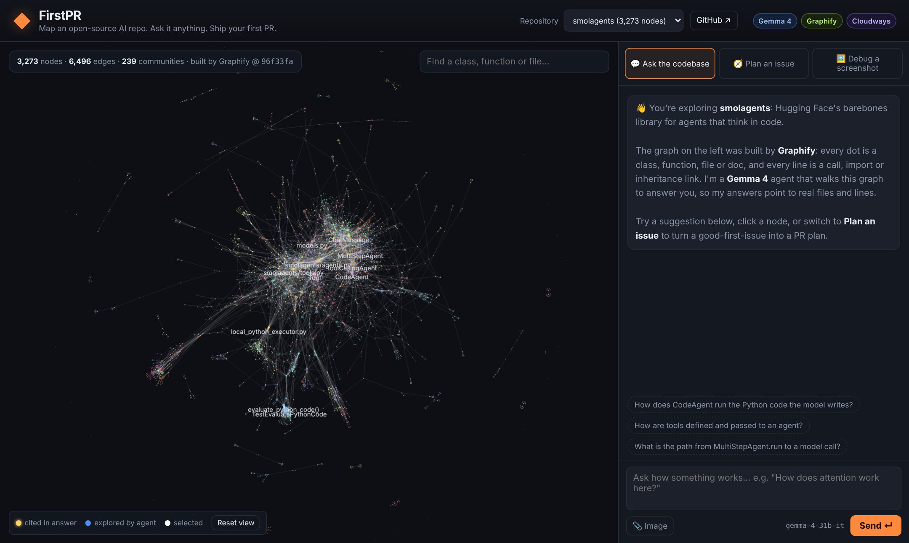
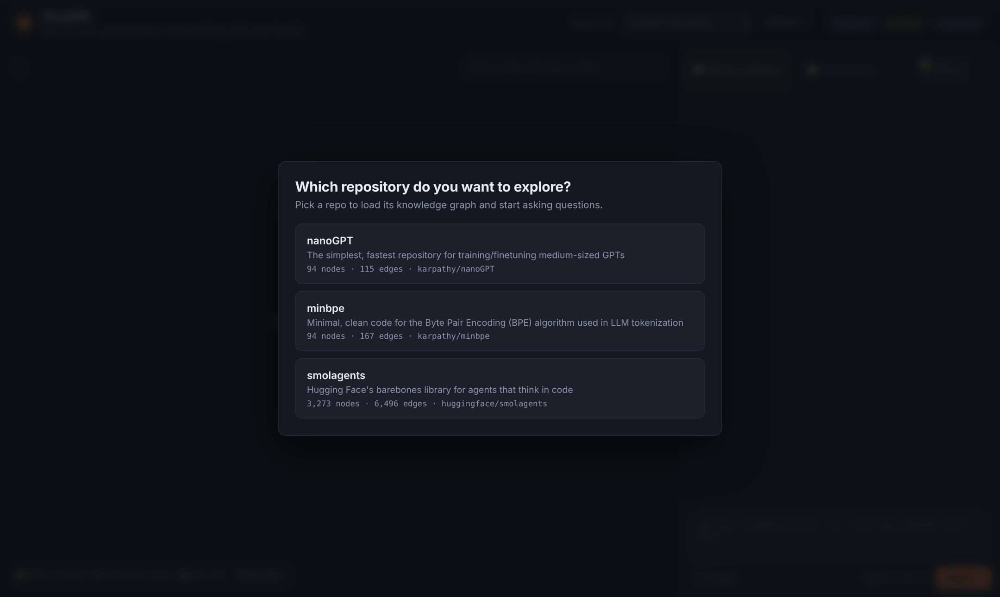
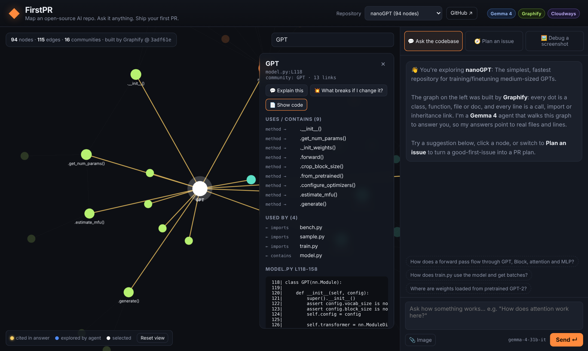
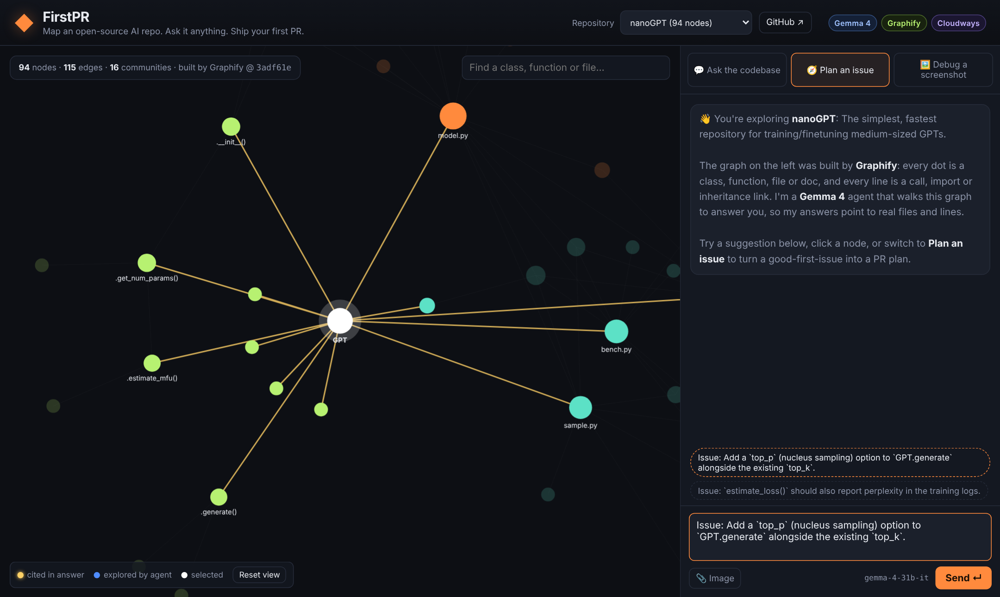
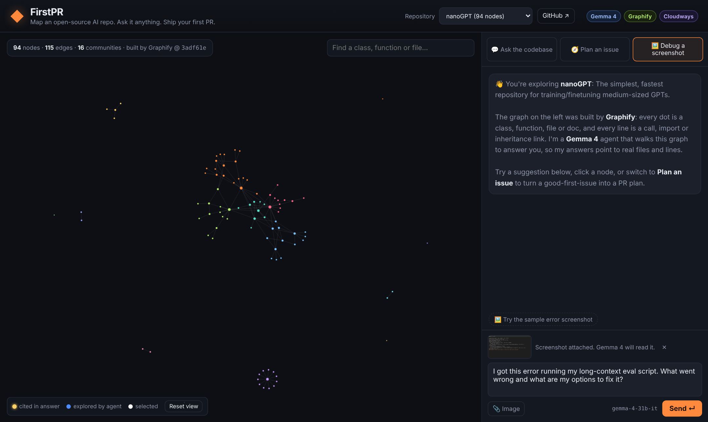
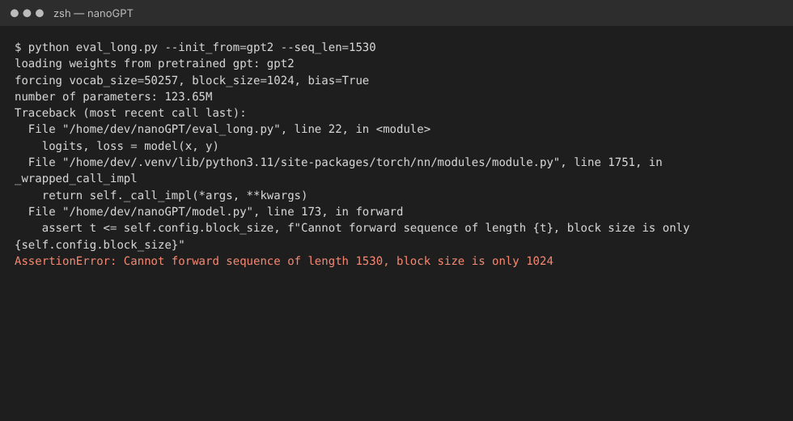
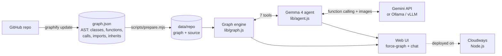

<div align="center">

# ◆ FirstPR

### Map an open-source AI repo. Ask it anything. Ship your first PR.

A **Gemma 4** agent that reasons over **Graphify** codebase knowledge graphs to help newcomers make their first open-source contribution, deployed live on **Cloudways**.


*Built at Hacktoberfest Hack Day Hyderabad × AI Community Hyderabad (MLH), 31 Oct 2026*



</div>

---

## 🤔 The problem

Hacktoberfest 2026 is about **open-source AI**. But opening a repo like `smolagents` for the first time means facing **3,000+ classes and functions**. Newcomers don't know where things live, how the pieces connect, or what their change might break.

- Generic AI chatbots **make up** file and function names.
- `grep` finds text but has **no idea how the code is structured**.
- Many first-time contributors give up before they open a PR.

## 💡 The solution

FirstPR turns any repo into a **Graphify knowledge graph** and puts a **Gemma 4 agent** on top of it. The agent explores the graph with **7 function-calling tools**, so each answer points to **real files, functions and line numbers**, and you can watch the cited code light up on the map.

---

## ✨ Features

### 1. Pick a repo and see its map



Three open-source AI repos come bundled: **nanoGPT**, **minbpe** and **smolagents**. Each one is a Graphify graph of classes, functions, files and docs, connected by calls, imports, inheritance and containment.

### 2. Explore any node



Search for any class or function, or click it on the graph, to see:
- **What it uses:** methods, calls and imports
- **What uses it:** callers, importers and subclasses
- **Its real source code**, with line numbers
- One-click **"Explain this"** and **"What breaks if I change it?"**

### 3. 💬 Ask the codebase

Ask in plain English, for example *"How does a forward pass flow through GPT, Block, attention and MLP?"* Gemma 4 calls graph tools such as `search_graph`, `explain_node` and `find_path`, then answers with **clickable node chips** that highlight on the graph. Every answer includes the **agent's trace**, so you can see exactly which tools it called.

### 4. 🧭 Plan an issue



Paste a **good-first-issue** and get back a contribution plan:
- **Where the change goes:** files, functions and line numbers
- **What could break:** the blast radius from `impact_of_change`, including dependents and the tests to run
- **A step-by-step plan** and a **suggested PR title**

### 5. 🖼️ Debug a screenshot



Paste, drag or upload a screenshot of an error. **Gemma 4's image input** reads the traceback, matches it to nodes in the graph and explains the cause and the fix.

<details>
<summary>Sample error screenshot included for the demo</summary>
<br/>

</details>

---

## 🏗️ How it works



### Agent tools

| Tool | What it does |
|---|---|
| `repo_overview` | Core abstractions (most connected nodes) and communities |
| `search_graph` | Find classes, functions and files by keyword |
| `explain_node` | Incoming and outgoing relationships, with `file:line` evidence |
| `find_path` | Shortest chain of relationships between two nodes |
| `impact_of_change` | Blast radius: dependents, affected files, likely tests |
| `nodes_in_file` | Symbols defined in a file |
| `read_source` | Real source code lines |

These tools are also available over HTTP (`POST /api/tool/:repo/:tool`), and the **agent skill** in [`skills/firstpr/SKILL.md`](skills/firstpr/SKILL.md) lets other coding agents use them.

---

## 🏆 Hackathon tracks

| Track | How FirstPR fits |
|---|---|
| **Best Open-Source AI Project** | Built on an open-weight model (Gemma 4) and an open-source graph harness (Graphify). Ships an **agent skill** and runs on **any self-hosted open-weight model** through Ollama, vLLM or llama.cpp. MIT licensed. |
| **Best Use of Gemma 4** | A focused learning and productivity tool that uses Gemma 4's **multimodal input** (screenshot debugging), **native function calling** (7-tool agent loop) and reasoning. |
| **Best Use of Graphify** | Our own agent reasons over Graphify knowledge graphs: shortest paths, blast radius, community overviews and grounded citations. New repos are added with one Graphify command. |
| **Best Use of Cloudways** | Deployed live as a Node.js app on Cloudways by DigitalOcean, straight from GitHub. |

---

## 🚀 Quick start

```bash
git clone https://github.com/Lokeshrao69/FirstPR.git
cd FirstPR
npm install
cp .env.example .env        # add GEMINI_API_KEY from https://aistudio.google.com/apikey
npm run start:local         # → http://localhost:3000
```

Run the offline tests, which use a mock model server:

```bash
npm test
```

### Run fully offline on a local open-weight model

```bash
ollama pull gemma4
LLM_PROVIDER=openai OPENAI_BASE_URL=http://localhost:11434/v1 OPENAI_MODEL=gemma4 npm start
```

### Add any GitHub repo

```bash
pip install graphifyy
./scripts/add-repo.sh https://github.com/owner/repo "Short description"
git add data && git commit -m "Add owner/repo" && git push
```

---

## ☁️ Deploy on Cloudways

1. In the Cloudways Platform, go to **Node.js**, then **Add Node.js App**.
2. Connect GitHub and select this repo on the `main` branch.
3. Choose Node **18 or later**. Install command: `npm install`. Start command: `npm start`.
4. Add the environment variable `GEMINI_API_KEY`. You can optionally set `GEMMA_MODEL=gemma-4-26b-a4b-it` for faster replies.
5. Click **Deploy Now**. `/api/health` should return `"key": true`.

| Variable | Default | Purpose |
|---|---|---|
| `GEMINI_API_KEY` | — | Gemini API key for Gemma 4 |
| `GEMMA_MODEL` | `gemma-4-31b-it` | Or `gemma-4-26b-a4b-it` |
| `GEMINI_RETRIES` | `5` | Retries on transient 429/5xx errors |
| `LLM_PROVIDER` | `gemini` | Set to `openai` for Ollama, vLLM or llama.cpp |
| `OPENAI_BASE_URL` / `OPENAI_MODEL` | — | Self-hosted model endpoint |
| `PORT` | `3000` | Set automatically by the host |

---

## 🧱 Tech stack

**Gemma 4** (Gemini API) · **Graphify** · **Node.js** · **Express** · **force-graph** · **marked** · **DOMPurify** · **Cloudways**

No database and no build step.

## 📁 Project structure

```
FirstPR/
├── server.js            # Express API + static hosting
├── lib/
│   ├── graph.js         # Graph engine (search, explain, path, impact, source)
│   └── agent.js         # Gemma 4 function-calling agent (+ OpenAI-compatible provider)
├── public/              # UI: graph visualisation + chat
├── data/                # Graphify graph bundles (nanoGPT, minbpe, smolagents)
├── scripts/             # add-repo.sh, prepare.mjs
├── skills/firstpr/      # Agent skill for other coding agents
├── test/                # Offline smoke tests with mock model servers
└── docs/                # Images + pitch kit
```

## 🗺️ Roadmap

- [ ] Import a GitHub issue directly from its URL
- [ ] Rank a repo's open issues by blast radius ("find me a good first issue")
- [ ] Add repos live from the UI

## 📄 License

MIT. See [LICENSE](LICENSE). The bundled sample repos keep their original licenses.
